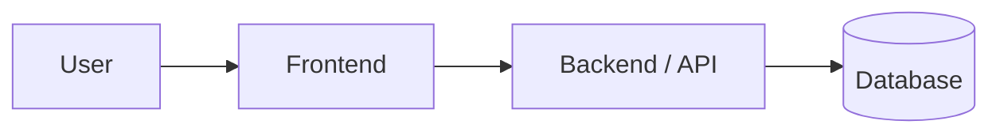
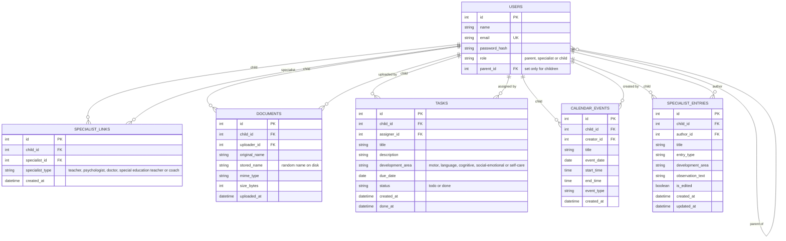
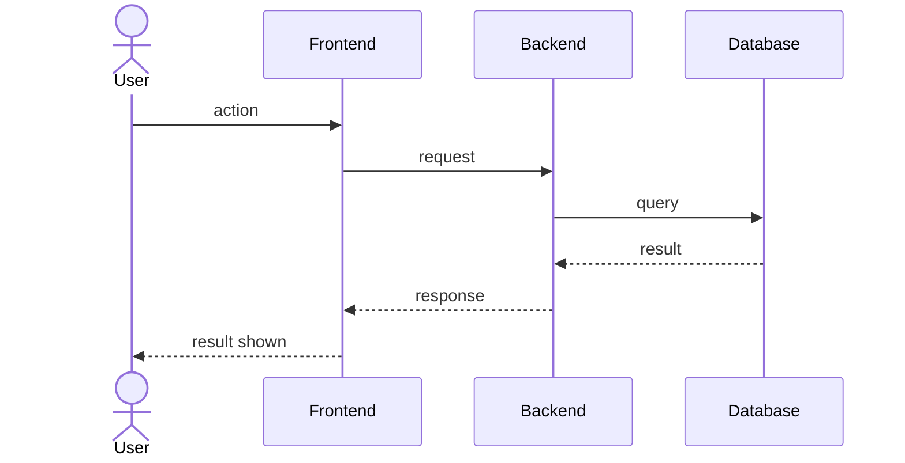
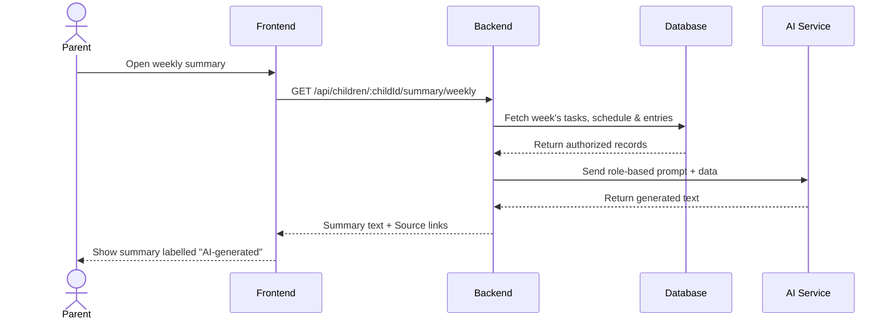

# Software Design Document (SDD)

**Team name:** Team Helix  
**Version:** ☐ First version (Week 6) ☐ Final (Week 10)  
**Last updated:** 2026-11-01

> Keep this file at `docs/SDD.md`. Describe how the system is built; the SRS describes what it does.
> Diagrams can be written in Mermaid (renders directly on GitHub) or added as images from `docs/img/`.
> Delete the guidance notes (lines starting with `>`) when you fill in a section.

---

## 1. Architecture Overview

> Describe the overall structure in 2–3 sentences (e.g., client–server, layered, frontend + REST API + database) and add one diagram.

### Technology Stack

| Layer | Technology |
|---|---|
| Frontend | React (Vite) |
| Backend | Node.js + Express, JWT authentication |
| Database | SQLite |
| Testing | Jest + Supertest (backend), Vitest (frontend), Playwright (end-to-end) |
| CI | GitHub Actions |

---

## 2. Module Design

> One row per module (M1–M8, same as your SRS and Jira epics). Name the main components (classes, services, pages) that implement each module.

| Module | Main components | Implements requirements |
|---|---|---|
| M1 – Login and roles | Backend: `routes/auth.js` (login, current user), `middleware/auth.js` (`authenticate`, `requireRole`), bcryptjs for password hashing, jsonwebtoken. Frontend: `LoginPage`, `AuthContext` (keeps the token and the current user), `ProtectedRoute` (role-based routing) | FR-M1-01 … FR-M1-08 |
| M2 – Linking specialists | Backend: `routes/children.js` (children of the current user), `routes/specialists.js` (link, list, unlink), `middleware/childAccess.js` (`requireChildAccess`). Frontend: `LinkedSpecialistsPage` (parent), `MyChildrenPage` (specialist) | FR-M2-01 … FR-M2-08 |
| M3 – Weekly schedule | Backend: `routes/schedule.js` (create, list), using `authenticate`, `requireRole` and `requireChildAccess`; input validation for title, date, time and event type. Frontend: `SchedulePage` (parent and specialist), `MySchedulePage` (child) | FR-M3-01 … FR-M3-06 |
| M4 – Tasks | Backend: `routes/tasks.js` (create, list, mark done), using `authenticate`, `requireRole` and `requireChildAccess`; input validation for title, development area and due date. Frontend: `TasksPage` (parent and specialist: task list and "assign task" form), `MyTasksPage` (child: own tasks and "mark as done") | FR-M4-01 … FR-M4-09 |
| M5 – Specialist entries | Backend: `routes/entries.js` (create, list, edit), using `authenticate`, `requireRole` (blocks child) and `requireChildAccess`; validation for date, entry type, area, title and text. Frontend: `EntriesPage` (parent and specialist) | FR-M5-01 … FR-M5-08 |
| M6 – Documents | Backend: `routes/documents.js` (upload, list, download), multer (file type check and 10 MB limit), files stored in `server/uploads/`. Frontend: `DocumentsPage` | FR-M6-01 … FR-M6-06 |
| M7 – Weekly statistics | Backend: `routes/statistics.js` (weekly completion rate), a helper that turns any date into its Monday–Sunday range, and one SQL query that counts tasks by status and `GROUP BY development_area`. Frontend: `StatisticsPage` (week selector, total rate, rate per area) | FR-M7-01 … FR-M7-06 |
| M8 – Role-based AI summary | Backend: `routes/summary.js` (generate weekly summary), using `authenticate`, `requireRole` (blocks child) and `requireChildAccess`; calls external AI API with role-based prompts and mock mode for tests. Frontend: `SummaryPage` | FR-M8-01 … FR-M8-09 |

### Access control

Every protected request passes through three middleware functions:

1. `authenticate` verifies the JWT and puts the user (id, role) on the request; a missing or invalid token returns 401.
2. `requireRole(...roles)` returns 403 if the user's role is not allowed for the endpoint.
3. `requireChildAccess` checks, on every request and against the database, that the user may access the child in the URL: a parent must be the child's parent, a specialist must have a row in `specialist_links`, and a child may only access their own data. Because the link is checked in the database and not in the token, an unlinked specialist is rejected even while their JWT is still valid (FR-M2-08).

All child-related endpoints use the prefix `/api/children/:childId/...`, so the same check applies to every module.

The JWT is signed with `JWT_SECRET` from `.env`, expires after 2 hours and is kept in the browser's localStorage. localStorage is readable by JavaScript, so an XSS bug could expose the token; we accept this for simplicity and reduce the risk by relying on React's default escaping (no `dangerouslySetInnerHTML`) and the short expiry.

---

## 3. Data Model

> Main entities and their relationships. A simple ER diagram is enough.

- A child is a user with the role `child`; `parent_id` links the child to their parent. A parent can have more than one child, and each child has one parent.
- `(child_id, specialist_id)` is unique in `specialist_links`, so a specialist cannot be linked to the same child twice. Unlinking deletes the row.
- Uploaded files are stored on disk under a random name, so user-supplied file names are never used as paths.
- A task belongs to one child and was assigned by one user (the parent or a linked specialist). Every task starts with the status `todo`; only the child can change it to `done`.
- `development_area` and `status` are text columns with a `CHECK` constraint, so only the allowed values can be stored.
- M7 has no table of its own: weekly statistics are calculated from `tasks` on every request, using `due_date` for the week and `status` for done tasks.
- `CALENDAR_EVENTS` belong to a child and are created by the parent or a linked specialist.
- `SPECIALIST_ENTRIES` store observations made by linked specialists. The `is_edited` flag is set to true if the entry is updated after creation.
- M8 (Role-based AI summary) has no dedicated table; summaries are generated on demand from tasks, schedule, and entries for the selected week.

---

## 4. API / Interfaces

> List the main endpoints or interfaces between components. Skip this section if your system has no API.

| Method | Endpoint | Description | Module |
|---|---|---|---|
| POST | `/api/auth/login` | Log in with email and password, returns a JWT and the user | M1 |
| GET | `/api/auth/me` | Current user (id, name, role) | M1 |
| GET | `/api/children` | Children of the current parent, or children linked to the current specialist | M2 |
| GET | `/api/children/:childId/specialists` | List specialists linked to the child | M2 |
| POST | `/api/children/:childId/specialists` | Link a specialist by email and type (parent only) | M2 |
| DELETE | `/api/children/:childId/specialists/:specialistId` | Unlink a specialist (parent only) | M2 |
| GET | `/api/children/:childId/documents` | List the child's documents | M6 |
| POST | `/api/children/:childId/documents` | Upload a PDF or image (max 10 MB) | M6 |
| GET | `/api/children/:childId/documents/:documentId/download` | Download a document | M6 |
| GET | `/api/children/:childId/tasks` | List the child's tasks: the parent and linked specialists get all of the child's tasks, the child gets their own | M4 |
| POST | `/api/children/:childId/tasks` | Assign a task with title, description, development area and due date (parent or linked specialist) | M4 |
| PATCH | `/api/children/:childId/tasks/:taskId/done` | Mark a task as done (child only) | M4 |
| GET | `/api/children/:childId/statistics/weekly?weekStart=YYYY-MM-DD` | Completion rate for the week, in total and by development area; defaults to the current week (parent and linked specialist) | M7 |
| GET | `/api/children/:childId/schedule` | List the child's calendar events (child, parent, linked specialists) | M3 |
| POST | `/api/children/:childId/schedule` | Add a calendar event (parent or linked specialist) | M3 |
| GET | `/api/children/:childId/entries` | List specialist entries for the child (parent and linked specialist only) | M5 |
| POST | `/api/children/:childId/entries` | Add a specialist entry (linked specialist only) | M5 |
| PATCH | `/api/children/:childId/entries/:entryId` | Edit a specialist entry (marks as edited) | M5 |
| GET | `/api/children/:childId/summary/weekly?weekStart=YYYY-MM-DD` | Generate role-based AI summary for the week (parent and linked specialist only) | M8 |

---

## 5. Critical Flows

> Use the same 3 critical flows as SRS Section 4. Add one sequence diagram for each.

### Flow 1:

### Flow 2:

### Flow 3:

---

## 6. User Interface

> Add sketches or screenshots of the main screens (hand-drawn wireframes are fine).

| Screen | Image | Module |
|---|---|---|
| | `docs/img/…` | |

---

## 7. Change Log

| Date | Change | By |
|---|---|---|
| 2026-10-25 | Template added | Yağız Yalçınöz |
| 2026-10-29 | M1, M2 and M6 design, data model and access control added | Yağız Yalçınöz |
| 2026-10-31 | M4 and M7 design, task data model and API endpoints added | Kerem Alp Ustaoğlu |
| 2026-11-01 | M3, M5 and M8 design, data model and API endpoints added | Zeynep Dila |