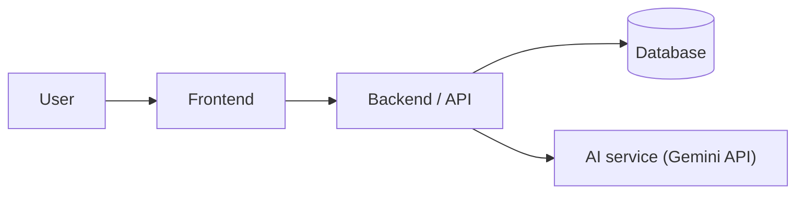
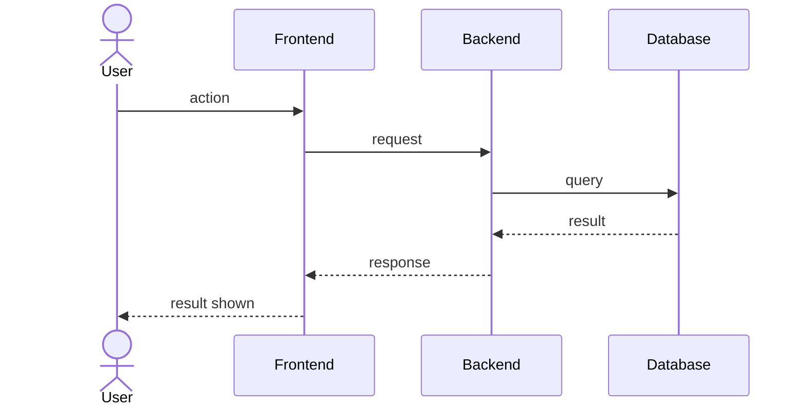
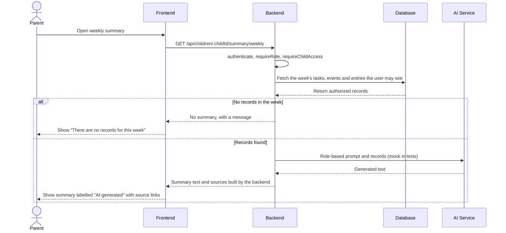

# Software Design Document (SDD)

**Team name:** Team Helix  
**Version:** ☐ First version (Week 6) ☐ Final (Week 10)  
**Last updated:** 2026-11-07

> Keep this file at `docs/SDD.md`. Describe how the system is built; the SRS describes what it does.
> Diagrams can be written in Mermaid (renders directly on GitHub) or added as images from `docs/img/`.
> Delete the guidance notes (lines starting with `>`) when you fill in a section.

---

## 1. Architecture Overview

> Describe the overall structure in 2–3 sentences (e.g., client–server, layered, frontend + REST API + database) and add one diagram.

### Technology Stack

| Layer | Technology |
|---|---|
| Frontend | React (Vite) |
| Backend | Node.js + Express, JWT authentication |
| Database | SQLite |
| Testing | Jest + Supertest (backend), Vitest (frontend), Playwright (end-to-end) |
| AI | Gemini API through `@google/genai`, with a mock mode for tests and CI |
| CI | GitHub Actions |

---

## 2. Module Design

> One row per module (M1–M8, same as your SRS and Jira epics). Name the main components (classes, services, pages) that implement each module.

| Module | Main components | Implements requirements |
|---|---|---|
| M1 – Login and roles | Backend: `routes/auth.js` (login, current user), `middleware/auth.js` (`authenticate`, `requireRole`), bcryptjs for password hashing, jsonwebtoken. Frontend: `LoginPage`, `AuthContext` (keeps the token and the current user), `ProtectedRoute` (role-based routing) | FR-M1-01 … FR-M1-08 |
| M2 – Linking specialists | Backend: `routes/children.js` (children of the current user), `routes/specialists.js` (link, list, unlink), `middleware/childAccess.js` (`requireChildAccess`). Frontend: `LinkedSpecialistsPage` (parent), `MyChildrenPage` (specialist) | FR-M2-01 … FR-M2-08 |
| M3 – Weekly schedule | Backend: `routes/schedule.js` (create, list), using `authenticate`, `requireRole` and `requireChildAccess`; input validation for title, date, time and event type. Frontend: `SchedulePage` (parent and specialist), `MySchedulePage` (child) | FR-M3-01 … FR-M3-06 |
| M4 – Tasks | Backend: `routes/tasks.js` (create, list, mark done), using `authenticate`, `requireRole` and `requireChildAccess`; input validation for title, development area and due date. Frontend: `TasksPage` (parent and specialist: task list and "assign task" form), `MyTasksPage` (child: own tasks and "mark as done") | FR-M4-01 … FR-M4-09 |
| M5 – Specialist entries | Backend: `routes/entries.js` (create, list, edit), using `authenticate`, `requireRole` (blocks child) and `requireChildAccess`; validation for date, entry type, area, title and text. Frontend: `EntriesPage` (parent and specialist) | FR-M5-01 … FR-M5-08 |
| M6 – Documents | Backend: `routes/documents.js` (upload, list, download), multer (file type check and 10 MB limit), files stored in `server/uploads/`. Frontend: `DocumentsPage` | FR-M6-01 … FR-M6-06 |
| M7 – Weekly statistics | Backend: `routes/statistics.js` (weekly completion rate), `getWeekRange` from `utils/week.js` (shared with M8) to turn any date into its Monday–Sunday range, and one SQL query that counts tasks by status and `GROUP BY development_area`. Frontend: `StatisticsPage` (week selector, total rate, rate per area) | FR-M7-01 … FR-M7-06 |
| M8 – Role-based AI summary | Backend: `routes/summary.js` (generate weekly summary), using `authenticate`, `requireRole` (blocks child) and `requireChildAccess`; calls the Gemini API only through the AI module in `server/src/ai/` (see [AI module](#ai-module-m8)), with role-based prompts and a mock mode for tests; uses `getWeekRange` from `utils/week.js` (shared with M7); stores "Helpful" / "Incorrect info" feedback in `ai_feedback`. Frontend: `SummaryPage` (summary, source links and feedback buttons) | FR-M8-01 … FR-M8-10 |

### Access control

Every protected request passes through three middleware functions:

1. `authenticate` verifies the JWT and puts the user (id, role) on the request; a missing or invalid token returns 401.
2. `requireRole(...roles)` returns 403 if the user's role is not allowed for the endpoint.
3. `requireChildAccess` checks, on every request and against the database, that the user may access the child in the URL: a parent must be the child's parent, a specialist must have a row in `specialist_links`, and a child may only access their own data. Because the link is checked in the database and not in the token, an unlinked specialist is rejected even while their JWT is still valid (FR-M2-08). A child id that is not a positive whole number returns 400. A child that does not exist returns the same 403 as a child the user may not access, so the API does not reveal which child ids exist.

Email addresses are stored in lower case and compared after trimming and lower-casing, so `Ayse@Example.com` and `ayse@example.com` are the same account.

Error responses of the access checks:

| Status | Response | When |
|---|---|---|
| 401 | `{ "error": "Authentication required" }` | No token, or a protected route without `authenticate` |
| 401 | `{ "error": "Invalid or expired token" }` | The token is invalid or expired; on `GET /api/auth/me` also when the user no longer exists |
| 403 | `{ "error": "You do not have permission to do this" }` | `requireRole`: the user's role is not allowed for the endpoint |
| 403 | `{ "error": "You do not have access to this child" }` | `requireChildAccess`: the child does not exist or the user may not access it |
| 400 | `{ "error": "Invalid child id" }` | `requireChildAccess`: `:childId` is not a positive whole number |

Routers mounted under `/api/children/:childId` are created with `express.Router({ mergeParams: true })`, so that `requireChildAccess` can read `:childId`.

All child-related endpoints use the prefix `/api/children/:childId/...`, so the same check applies to every module.

The JWT is signed with `JWT_SECRET` from `.env` (optional, see `server/.env.example`; without it a random secret is created at startup, so no secret is stored in the repository), expires after 2 hours and is kept in the browser's localStorage. localStorage is readable by JavaScript, so an XSS bug could expose the token; we accept this for simplicity and reduce the risk by relying on React's default escaping (no `dangerouslySetInnerHTML`) and the short expiry.

### AI module (M8)

**Provider.** Gemini API, chosen by the team on 2026-11-07. The M8 developer has used the Gemini API before, and a free API key can be created in Google AI Studio. The backend uses the official Node.js SDK `@google/genai`.

**One module.** Every AI call goes through `server/src/ai/`; `routes/summary.js` never calls the SDK directly.

| File | Role |
|---|---|
| `ai/index.js` | `generateSummary({ role, week, records })`: chooses the mode, builds the prompt, calls the provider and returns the text |
| `ai/prompts.js` | The parent prompt and the specialist prompt |
| `ai/mock.js` | The mock summary |

**Modes.**

| `AI_MODE` | Behaviour |
|---|---|
| `mock` (default) | Returns a fixed summary built from the record counts, for example "This week, 3 of 5 tasks were completed." The same records always give the same text, so tests can check it. |
| `gemini` | Sends the prompt to the Gemini API |

In tests (`NODE_ENV=test`) the mode is always `mock`, whatever `.env` says, so tests and CI never call the external API. If `AI_MODE=gemini` and `GEMINI_API_KEY` is missing, the server does not start and says which variable is missing.

**Configuration.** `AI_MODE`, `GEMINI_API_KEY` and `GEMINI_MODEL` are read from `server/.env`. The model name is not written in the code, because Gemini model names change often; the default is chosen from the Gemini documentation when M8 is implemented and noted in `server/.env.example`. The API key stays on the backend: it is never sent to the frontend and never committed, since `.env` is in `.gitignore`.

**Prompts (FR-M8-03, FR-M8-04).** There is one prompt for parents and one for specialists:

- Parent: plain language; what was done this week and what is planned.
- Specialist: grouped by development area, using the entry types (observation, session note, evaluation).

Both prompts contain the same rules: use only the given records, say when information is missing, and never make decisions, diagnoses or treatment suggestions.

**What is sent to the AI (FR-M8-02).** The backend first checks access (`requireRole`, `requireChildAccess`), then selects only the records of the selected week that the user may see, and sends only those. Writing "do not show restricted data" in a prompt is not access control, so restricted records are never sent at all. Names, email addresses and ids are not sent either: the child is called "the child", and each record is sent with only its type, date, title, development area, status or text.

**Source links (FR-M8-05).** The list of sources is built by the backend from the records it sent, not from the AI's answer, so a source invented by the model can never be shown. The frontend shows the summary with the "AI-generated" label and a link to each source record.

**No records (FR-M8-09).** If the week has no tasks, calendar events or specialist entries, the backend does not call the AI and returns no summary, with a message.

**Errors.** If the provider returns an error or does not answer within 15 seconds, the endpoint returns 502 and the rest of the application keeps working. The details are logged on the server and not sent to the client.

---

## 3. Data Model

> Main entities and their relationships. A simple ER diagram is enough.

```mermaid
erDiagram
    USERS ||--o{ USERS : "parent of"
    USERS ||--o{ SPECIALIST_LINKS : "child"
    USERS ||--o{ SPECIALIST_LINKS : "specialist"
    USERS ||--o{ DOCUMENTS : "child"
    USERS ||--o{ DOCUMENTS : "uploaded by"
    USERS {
        int id PK
        string name
        string email UK
        string password_hash
        string role "parent, specialist or child"
        int parent_id FK "set only for children"
    }
    SPECIALIST_LINKS {
        int id PK
        int child_id FK
        int specialist_id FK
        string specialist_type "teacher, psychologist, doctor, special education teacher or coach"
        datetime created_at
    }
    DOCUMENTS {
        int id PK
        int child_id FK
        int uploader_id FK
        string original_name
        string stored_name "random name on disk"
        string mime_type
        int size_bytes
        datetime uploaded_at
    }
    USERS ||--o{ TASKS : "child"
    USERS ||--o{ TASKS : "assigned by"
    TASKS {
        int id PK
        int child_id FK
        int assigner_id FK
        string title
        string description
        string development_area "motor, language, cognitive, social-emotional or self-care"
        date due_date
        string status "todo or done"
        datetime created_at
        datetime done_at
    }
    USERS ||--o{ CALENDAR_EVENTS : "child"
    USERS ||--o{ CALENDAR_EVENTS : "created by"
    USERS ||--o{ SPECIALIST_ENTRIES : "child"
    USERS ||--o{ SPECIALIST_ENTRIES : "author"
    CALENDAR_EVENTS {
        int id PK
        int child_id FK
        int creator_id FK
        string title
        date event_date "YYYY-MM-DD"
        time start_time "HH:MM"
        time end_time "HH:MM, optional"
        string event_type "school, support, health, sports or other"
        datetime created_at
    }
    SPECIALIST_ENTRIES {
        int id PK
        int child_id FK
        int author_id FK
        date entry_date "date of the observation, chosen by the specialist"
        string title
        string entry_type
        string development_area
        string observation_text
        boolean is_edited
        datetime created_at
        datetime updated_at
    }
    USERS ||--o{ AI_FEEDBACK : "child"
    USERS ||--o{ AI_FEEDBACK : "given by"
    AI_FEEDBACK {
        int id PK
        int child_id FK "child the summary is about"
        int user_id FK "parent or linked specialist who gave the rating"
        date week_start "Monday of the summarized week"
        string rating "helpful or incorrect"
        datetime created_at
    }
```

- A child is a user with the role `child`; `parent_id` links the child to their parent. A parent can have more than one child, and each child has one parent.
- `(child_id, specialist_id)` is unique in `specialist_links`, so a specialist cannot be linked to the same child twice. Unlinking deletes the row.
- Uploaded files are stored on disk under a random name, so user-supplied file names are never used as paths.
- A task belongs to one child and was assigned by one user (the parent or a linked specialist). Every task starts with the status `todo`; only the child can change it to `done`.
- `development_area` and `status` are text columns with a `CHECK` constraint, so only the allowed values can be stored.
- M7 has no table of its own: weekly statistics are calculated from `tasks` on every request, using `due_date` for the week and `status` for done tasks.
- `CALENDAR_EVENTS` belong to a child and are created by the parent or a linked specialist. FR-M3-01 asks for one time, so `start_time` is required and `end_time` is optional; when it is given, it must be after `start_time`. Dates are stored as `YYYY-MM-DD` and times as `HH:MM`, and `CHECK` constraints reject any other format, because the weekly view and M8 compare dates as text (`event_date BETWEEN ...`), which only works when every date has the same format.
- `SPECIALIST_ENTRIES` store observations made by linked specialists. `entry_date` is the date of the observation, entered by the specialist (FR-M5-01); it can differ from `created_at`, which is when the entry was saved. The `is_edited` flag is set to true if the entry is updated after creation.
- A week runs from Monday to Sunday. To decide which records belong to a week, tasks use `due_date`, calendar events use `event_date` and specialist entries use `entry_date`, so M7 and M8 use the same definition of a week. Both use one helper, `getWeekRange(date)` in `server/src/utils/week.js`, which returns the Monday and Sunday of the week that contains the given date.
- M8 summaries are not stored; they are generated on demand from the tasks, calendar events and specialist entries of the selected week. Only feedback is stored, in `AI_FEEDBACK` (FR-M8-06).
- In `AI_FEEDBACK`, `child_id` is the child the summary is about and `user_id` is the parent or linked specialist who rated it; the child never sees summaries (FR-M8-08), so a child cannot give feedback. `(child_id, user_id, week_start)` is unique, so each user gives one rating per child and week; rating again replaces the earlier rating. `rating` is a text column with a `CHECK` constraint (`helpful` or `incorrect`). The summary text itself is not stored: it would come from the client, so the server could not check that it is the real summary, and it would keep a copy of the child's data outside the source records.

---

## 4. API / Interfaces

> List the main endpoints or interfaces between components. Skip this section if your system has no API.

| Method | Endpoint | Description | Module |
|---|---|---|---|
| POST | `/api/auth/login` | Log in with email and password, returns a JWT and the user | M1 |
| GET | `/api/auth/me` | Current user (id, name, role) | M1 |
| GET | `/api/children` | Children of the current parent, or children linked to the current specialist | M2 |
| GET | `/api/children/:childId/specialists` | List specialists linked to the child | M2 |
| POST | `/api/children/:childId/specialists` | Link a specialist by email and type (parent only) | M2 |
| DELETE | `/api/children/:childId/specialists/:specialistId` | Unlink a specialist (parent only) | M2 |
| GET | `/api/children/:childId/documents` | List the child's documents | M6 |
| POST | `/api/children/:childId/documents` | Upload a PDF or image (max 10 MB) | M6 |
| GET | `/api/children/:childId/documents/:documentId/download` | Download a document | M6 |
| GET | `/api/children/:childId/tasks` | List the child's tasks: the parent and linked specialists get all of the child's tasks, the child gets their own | M4 |
| POST | `/api/children/:childId/tasks` | Assign a task with title, description, development area and due date (parent or linked specialist) | M4 |
| PATCH | `/api/children/:childId/tasks/:taskId/done` | Mark a task as done (child only) | M4 |
| GET | `/api/children/:childId/statistics/weekly?weekStart=YYYY-MM-DD` | Completion rate for the week, in total and by development area; defaults to the current week (parent and linked specialist) | M7 |
| GET | `/api/children/:childId/schedule` | List the child's calendar events (child, parent, linked specialists) | M3 |
| POST | `/api/children/:childId/schedule` | Add a calendar event (parent or linked specialist) | M3 |
| GET | `/api/children/:childId/entries` | List specialist entries for the child (parent and linked specialist only) | M5 |
| POST | `/api/children/:childId/entries` | Add a specialist entry (linked specialist only) | M5 |
| PATCH | `/api/children/:childId/entries/:entryId` | Edit a specialist entry (marks as edited) | M5 |
| GET | `/api/children/:childId/summary/weekly?weekStart=YYYY-MM-DD` | Generate role-based AI summary for the week; defaults to the current week (parent and linked specialist only) | M8 |
| POST | `/api/children/:childId/summary/feedback` | Rate the week's summary as helpful or incorrect, with `weekStart` and `rating`; replaces the user's earlier rating for that week (parent and linked specialist only) | M8 |

### Authentication API format

All errors use the format `{ "error": "message" }`.

**POST `/api/auth/login`**

Request: `{ "email": "...", "password": "..." }`

| Status | Response |
|---|---|
| 200 | `{ "token": "...", "user": { "id": 1, "name": "...", "role": "parent" } }` |
| 400 | `{ "error": "Email and password are required" }` |
| 401 | `{ "error": "Invalid email or password" }` |

**GET `/api/auth/me`**

Header: `Authorization: Bearer <token>`

| Status | Response |
|---|---|
| 200 | `{ "user": { "id": 1, "name": "...", "role": "parent" } }` |
| 401 (no token) | `{ "error": "Authentication required" }` |
| 401 (invalid or expired token) | `{ "error": "Invalid or expired token" }` |

### AI summary API format

**GET `/api/children/:childId/summary/weekly?weekStart=YYYY-MM-DD`**

Header: `Authorization: Bearer <token>`

`weekStart` is optional and can be any day of the week; the server turns it into that week's Monday with `getWeekRange`. Without it, the current week is used.

| Status | Response |
|---|---|
| 200 | `{ "summary": { "weekStart": "2026-11-02", "weekEnd": "2026-11-08", "text": "...", "aiGenerated": true, "sources": [{ "type": "task", "id": 12, "title": "Read for 20 minutes", "date": "2026-11-04" }] } }` |
| 200 (no records in the week, FR-M8-09) | `{ "summary": null, "message": "There are no records for this week" }` |
| 400 (invalid date) | `{ "error": "weekStart must be a date in YYYY-MM-DD format" }` |
| 401 | Same as for every protected endpoint (see above) |
| 403 | The user is a child, a parent of another child, or a specialist who is not linked to the child |
| 502 | `{ "error": "The AI summary is not available right now" }` |

`sources[].type` is `task`, `event` or `entry`. A week without records returns 200, not an error, because it is a normal state that the page shows as a message.

### AI summary feedback API format

**POST `/api/children/:childId/summary/feedback`**

Header: `Authorization: Bearer <token>`

Request: `{ "weekStart": "YYYY-MM-DD", "rating": "helpful" }` (`rating` is `helpful` or `incorrect`)

`weekStart` can be any day of the week: the server turns it into that week's Monday with `getWeekRange`, so the same week is always stored with the same `week_start` and a user cannot rate one week twice.

| Status | Response |
|---|---|
| 200 | `{ "feedback": { "weekStart": "2026-11-02", "rating": "helpful" } }` |
| 400 (invalid rating) | `{ "error": "Rating must be helpful or incorrect" }` |
| 400 (invalid date) | `{ "error": "weekStart must be a date in YYYY-MM-DD format" }` |
| 400 (no records in the week, FR-M8-09) | `{ "error": "There is no summary for this week" }` |
| 401 | Same as for every protected endpoint (see above) |
| 403 | The user is a child, a parent of another child, or a specialist who is not linked to the child |

---

## 5. Critical Flows

> Use the same 3 critical flows as SRS Section 4. Add one sequence diagram for each.

### Flow 1:

### Flow 2:

### Flow 3:

---

## 6. User Interface

> Add sketches or screenshots of the main screens (hand-drawn wireframes are fine).

| Screen | Image | Module |
|---|---|---|
| | `docs/img/…` | |

---

## 7. Change Log

| Date | Change | By |
|---|---|---|
| 2026-10-25 | Template added | Yağız Yalçınöz |
| 2026-10-29 | M1, M2 and M6 design, data model and access control added | Yağız Yalçınöz |
| 2026-10-31 | M4 and M7 design, task data model and API endpoints added | Kerem Alp Ustaoğlu |
| 2026-11-01 | M3, M5 and M8 design, data model and API endpoints added | Zeynep Dila Tetik |
| 2026-11-03 | Login and current user API format added | Yağız Yalçınöz |
| 2026-11-06 | M5 observation date, M8 feedback table, endpoint and API format, and shared week helper added | Zeynep Dila Tetik |
| 2026-11-06 | M3 calendar event time rules and date and time formats added | Zeynep Dila Tetik |
| 2026-11-07 | AI module design (Gemini API, mock mode, prompts, data sent to the AI), summary API format and Flow 3 updated | Zeynep Dila Tetik |
